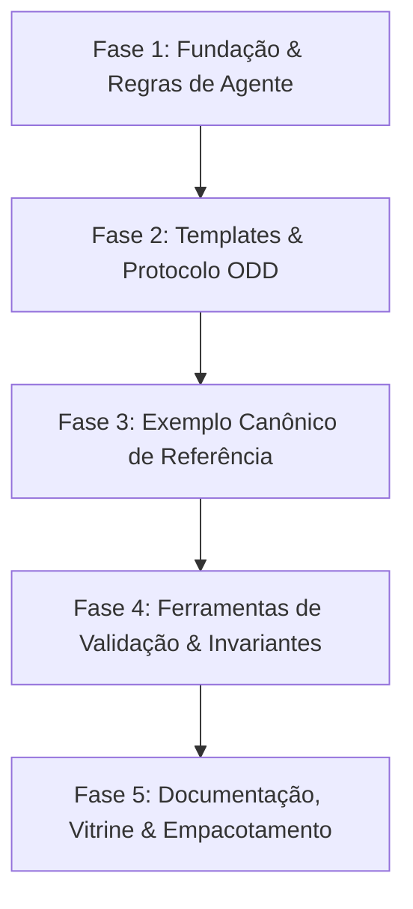

# Roadmap de Execução: ABM AI Guidelines (Estilo REA)

Este documento traduz o [plan.md](file:///c:/Users/FIB/Documents/GitHub/ABM%20skills/plan.md) em um plano de ação estruturado em etapas incrementais e executáveis. O projeto adota a filosofia de empoderamento inspirada no [morluto/rea](https://github.com/morluto/rea): **permitir que pesquisadores que dominam o fenômeno, mas não a programação, construam simulações baseadas em agentes (ABM) rigorosas, documentadas (ODD) e reproduzíveis com auxílio de agentes de IA.**

---

## Visão do Produto & Filosofia

| Princípio REA | Equivalente no ABM Guidelines |
|---|---|
| **Acessibilidade Radical** | Qualquer pesquisador consegue criar um ABM em Python/Mesa sem ser engenheiro de software. |
| **Evidence-Based (Sem Alucinação)** | A IA é estritamente proibida de inventar regras comportamentais. Toda linha de código de decisão deve citar a seção do protocolo ODD ou pressuposto aprovado pelo pesquisador. |
| **Workflow em Fases** | **Elicit** (Entrevista) $\rightarrow$ **Formalize** (ODD) $\rightarrow$ **Simulate** (Mesa) $\rightarrow$ **Verify** (Invariantes e Experimentos). |
| **Pronto para Agentes** | Suporte nativo para os principais agentes do mercado (Cursor, Claude Code, Antigravity, Copilot, etc.) via `.agents/skills` e `AGENTS.md`. |

---

## Visão Geral das Etapas

---

## Detalhamento das Etapas

### Fase 1: Fundação & Governança da IA (Core Rules & Guardrails)
> **Objetivo:** Estabelecer as regras inegociáveis para que a IA atue como uma copiloto metodológica rigorosa e nunca invente ciência ou código arbitrário.

- [x] **1.1. Criar `AGENTS.md` (Instruções Globais para IAs):**
  - Diretrizes gerais de comportamento.
  - Proibição estrita de criar regras de agentes não documentadas.
  - Regra de parada: quando perguntar ao pesquisador em vez de presumir.
  - Princípio de implementação atômica (uma tarefa por vez).
  - Rastreabilidade obrigatória (comentários no código apontando para seções ODD).
- [x] **1.2. Criar pasta `.agents/rules/` com regras modulares e triggers:**
  - `.agents/rules/human-review.md`: Critérios de quando a IA DEVE pausar e solicitar validação teórica (always_on).
  - `.agents/rules/no-undocumented-assumptions.md`: Protocolo de tags `[DECISION NEEDED]` / `[ASSUMPTION]` (always_on).
  - `.agents/rules/task-management.md`: Como a IA deve gerenciar e atualizar o TASKS.md (always_on).
  - `.agents/rules/reproducibility.md`: Uso obrigatório de seeds estocásticas, controle de aleatoriedade e isolamento de parâmetros (model_decision).
  - `.agents/rules/code-organization.md`: Separação estrita de responsabilidades (model_decision).
- [x] **1.3. Criar a Skill Principal do Agente (`.agents/skills/abm-modeler/`), autocontida:**
  - `SKILL.md`: orquestrador com etapas em portões, critérios de saída e pontos de entrada.
  - `references/guardrails.md`: regras essenciais embutidas (portáveis sem `.agents/rules/`).
  - `references/stage-1-elicit.md` … `stage-4-verify.md`: uma referência detalhada por etapa.

#### Decisões da revisão da Fase 1
- A skill é a unidade instalável (estilo REA): tudo que ela precisa fica dentro de `abm-modeler/`.
- Uma skill orquestradora (não 4 separadas), sem perder verbosidade: detalhes ficam em `references/`.
- Duas tags: `[DECISION NEEDED]` (bloqueia; proibida em código) e `[ASSUMPTION]` (provisória aceita; exige entrada no decision-log).
- Mesa 3.x: sem schedulers (AgentSet), `seed` via `super().__init__`, conferir versão instalada.

---

### Fase 2: Templates & Metodologia Formal
> **Objetivo:** Fornecer os artefatos estruturados que guiarão o diálogo entre o pesquisador e a IA, garantindo padrões acadêmicos.

> **Local:** os templates ficam dentro da skill, em `.agents/skills/abm-modeler/resources/` (decisão da revisão da Fase 1), e seguem a numeração ODD de `references/stage-2-formalize.md`.

- [x] **2.1. Template ODD (`resources/odd-template.md`):**
  - Estrutura completa do protocolo padrão de ABM (Overview, Design Concepts, Details).
  - Blocos de instrução em HTML com critérios de validação e seções de submodelos.
  - Seção RAW de referência de Grimm et al. com instrução de consulta sob aviso ao usuário.
- [x] **2.2. Template de Especificação Conceitual (`resources/model-specification.md`):**
  - Formulário conversacional guiado cobrindo as 12 dimensões diagnósticas da entrevista.
  - Tabela de mapeamento direto de cada dimensão para sua respectiva seção do ODD.
- [x] **2.3. Log de Decisões e Pressupostos (`resources/decision-log.md`):**
  - Tabela append-only com rastreamento de decisões (#ID, data, etapa, tópico, decisão, alternativas, justificativa, autor, status).
- [x] **2.4. Template de Experimentos (`resources/experiment-config.yaml`):**
  - Padrão declarativo completo com model_parameters, run_controls, cenários teóricos nomeados e parameter_sweep para batch_run.

---

### Fase 3: Exemplo Canônico de Referência (Golden Example)
> **Objetivo:** Construir um projeto exemplo completo (`examples/opinion-dynamics/`) para provar o conceito e servir de espelho para a IA ao criar novos modelos.

- [ ] **3.1. Documentação do Exemplo:**
  - `examples/opinion-dynamics/README.md`: Explicação do modelo de dinâmica de opiniões (Bounded Confidence / Deffuant-Weisbuch).
  - `examples/opinion-dynamics/specification.md`: O formulário de entrevista preenchido.
  - `examples/opinion-dynamics/odd.md`: Protocolo ODD completo e rigoroso deste modelo.
  - `examples/opinion-dynamics/decision-log.md`: As decisões teóricas registradas.
- [ ] **3.2. Implementação em Python (Mesa):**
  - `examples/opinion-dynamics/agents.py`: Implementação dos agentes de opinião com anotações de regras ODD.
  - `examples/opinion-dynamics/model.py`: Modelo com espaço (rede ou grade/contínuo), agendamento e DataCollector.
  - `examples/opinion-dynamics/experiments.py`: Execução de cenários (ex: polarização vs consenso) e controle de seeds.
  - `examples/opinion-dynamics/metrics.py`: Análise e visualização da convergência de opiniões.
  - `examples/opinion-dynamics/requirements.txt`: Dependências mínimas (`mesa`, `numpy`, `matplotlib`, `pytest`).
- [ ] **3.3. Testes de Invariantes e Sanidade:**
  - `examples/opinion-dynamics/tests/test_model.py` (checks V1–V8 de `references/stage-4-verify.md`):
    - Garantir que a opinião sempre permanece no intervalo $[0, 1]$.
    - Garantir que a conservação de agentes é respeitada.
    - Garantir que a mesma seed gera exatamente os mesmos resultados (reprodutibilidade estrita).

---

### Fase 4: Ferramentas & Scripts Auxiliares (O Toque Estilo REA)
> **Objetivo:** Adicionar ferramentas automatizadas que a IA ou o usuário podem executar para validar a modelagem.

- [ ] **4.1. Validador de ODD e Especificação (`tools/odd_validator.py`):**
  - Script que verifica se todas as seções obrigatórias do ODD foram preenchidas, se ainda há `[DECISION NEEDED]` e se todo `[ASSUMPTION]` tem entrada no decision-log.
- [ ] **4.2. Test Runner de Reprodutibilidade e Invariantes (`tools/verify_model.py`):**
  - Script padronizado que a IA pode rodar após gerar código para atestar que o modelo roda sem quebras e respeita os invariantes básicos.
- [ ] **4.3. Script de Scaffold (`tools/scaffold_abm.py` ou setup):**
  - Comando simples que inicializa uma nova pasta de projeto de ABM com os templates, `TASKS.md` e regras prontos.

---

### Fase 5: Documentação, Apresentação & Empacotamento
> **Objetivo:** Tornar o repositório claro, atraente e pronto para ser usado por pesquisadores e submetido em artigo acadêmico.

- [x] **5.1. `README.md` Principal:**
  - Versão inicial criada com visão geral, arquitetura, workflow em 4 etapas e guia de uso (será mantido e atualizado continuamente ao longo das fases).
- [ ] **5.2. `TASKS.md` Inicial:**
  - Quadro de tarefas com estados (Pending, In Progress, Completed, Decisions Needed) pronto para o usuário.
- [ ] **5.3. Metadados Acadêmicos:**
  - `CITATION.cff`: Para que pesquisadores que usem a metodologia citem o trabalho no futuro paper.
  - `LICENSE`: Definição de licença aberta (MIT ou similar).

---

## Próxima Ação Imediata

Revisar a Fase 1 com o pesquisador e, após aprovação, iniciar a **Fase 2** (templates em `.agents/skills/abm-modeler/resources/`).
